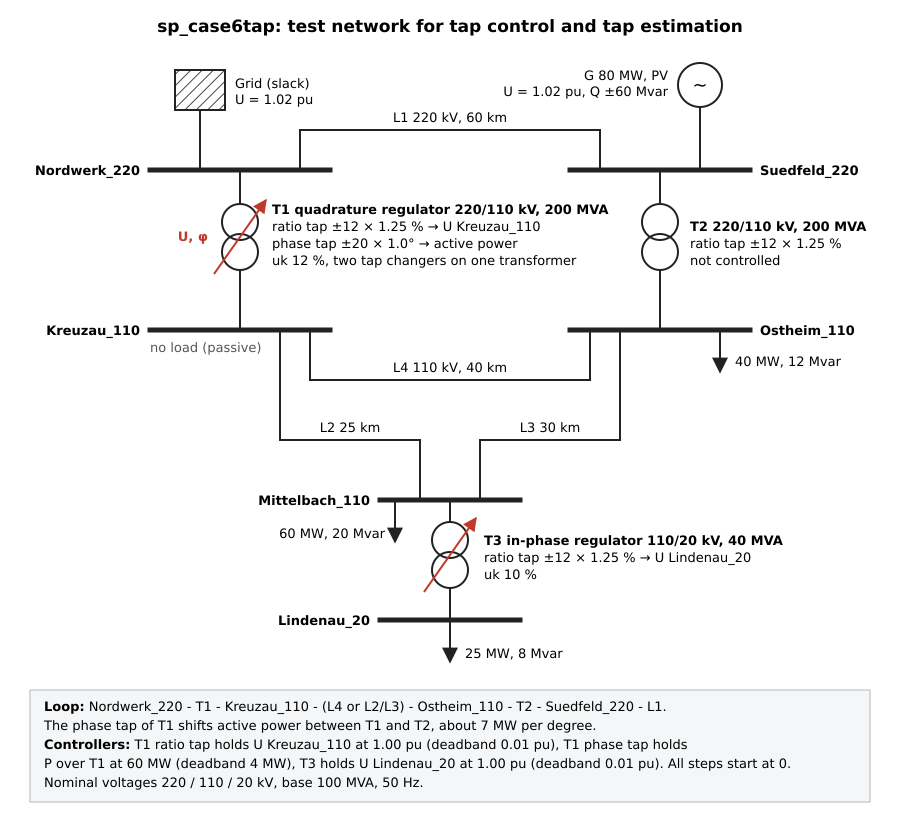

# Shipped Demo Cases

Sparlectra ships five self-built networks in the [Sparlectra Case
Format](scf.md), tracked in `data/scf`, so a fresh install can run power
flow, state estimation, short circuit, N-1 and scenarios without
downloading anything.

!!! note "Provenance"
    These networks were built for Sparlectra. They are not the IEEE cases
    of the same bus count, and no data was taken from MATPOWER, DTF or any
    other source. Every number was chosen at construction or derived from
    a solved run of that construction, with fixed seeds.

The number in the name is the bus count, the `sp_` prefix marks them as
Sparlectra's own. Components carry invented place names: busbars
`<Ort>_<kV>` (`Ostheim_110`, `Moorau_20`; a second busbar section gets a
`b` suffix), lines by their endpoints (`Ostheim_Neuwiese_1`/`_2` for a
double circuit; sp_case60's deliberate same-name pair carries the bare
corridor name on both legs), transformers by station plus both voltage
levels (`Moorau_110_20`; `sp_case6tap` names them `T<n>_<from>_<to>`,
`T1_Nordwerk_Kreuzau`, after the labels of its single-line diagram); the
short technical handle (`H1`, `A12`, `MC9`) stays in the file as
`external_id`. Each case except `sp_case6tap` ships with measurements (a
noisy CSV with the seed in the header, plus a bad-data variant with one
gross reading), a scenarios block (explicit mode; N-1 expansions are
chosen on the Runs page), short-circuit study buses and a solved start
state. `sp_case6tap` ships with one measurement table and nothing else of
this list.

| Case | Buses | What it demonstrates |
|---|---|---|
| `sp_case5` | 5 | The hand-checkable entry: two voltage levels, an external grid as slack and IEC 60909 feeder, one PV machine, ratings chosen so that line outages overload the surviving parallel path (`line_Borntal_Lindhof_out`: 122 percent) while the base keeps 32 percent reserve. |
| `sp_case6tap` | 6 | The tap control case: three transformers, two of them regulated, see [sp_case6tap](@ref sp_case6tap_tap_control). Power flow, short circuit and state estimation on a measurement table taken from the settled controller state (no bad-data variant). |
| `sp_case14` | 14 | The regulated feeder: a meshed 110 kV level, a radial 20 kV feeder behind a transformer with a discrete tap controller (deadband 0.01 pu, settles in 5 outer iterations), a fixed-tap transformer off neutral, and N-1 outages that island the load-only feeder. |
| `sp_case60` | 60 | The feature-dense operated grid: 220/110/20 kV, a PST holding its corridor flow, a combined ratio-and-phase Schraegregler, an SVC, a 40 percent series-compensated corridor, a same-name double circuit across two busbar sections joined by an impedance-less link, and a bridge branch whose outage island solves via PV promotion. No branch above 80 percent in the base case: the screening fixture. |
| `sp_case188` | 188 | The benchmark: a 380 kV double ring with a double busbar, a steerable HVDC pair (60 MW setpoint), four parametric 110/20 kV zones, a STATCOM with a remote target, an SSSC, a PST and a series-compensated corridor. |

`data/mpower/sp_case118.m` is a shipped MATPOWER file: a synthetic
118-bus case with the cardinalities of the IEEE 118-bus system (118
buses, 186 branches of which 9 transformers, 54 generators with a good
third of synchronous condensers, 99 loads, three areas, an 11-bus 345 kV
backbone over a 138 kV grid) and its own topology, parameters and names.
It stands in for the downloaded IEEE case in the APSLF and scenarios
workshops: several machines sit at a reactive limit, every branch keeps
25 percent headroom, and a handful of N-1 outages island a bus or do not
converge.

In the Web UI the shipped cases appear in the case chooser
([Case selector](@ref webui-case-selector)). Programmatically, load them
like any other SCF file:

```julia
using Sparlectra
path = joinpath(pkgdir(Sparlectra), "data", "scf", "sp_case14.scf.json")
res = Sparlectra.import_case(path, load_sparlectra_config())
runpf!(res.net)
```

Reference values (bus voltages, iterations, losses, N-1 summary counts,
state-estimation objective and degrees of freedom, short-circuit currents
at two buses) live in `test/fixtures/demo_cases/` and
`data/scf/README.md`.

## [sp_case6tap: tap control and tap estimation](@id sp_case6tap_tap_control)

`sp_case6tap` is a small net for tap control and tap estimation, written
by hand. Two 220 kV buses feed a meshed 110 kV level through the coupling
transformers T1 and T2, which close a loop; T3 feeds a 20 kV load bus.

- `T1_Nordwerk_Kreuzau`, 220/110 kV, 200 MVA, with two tap changers: a
  ratio changer (+-12 steps of 1.25 percent) and a phase changer (+-20
  steps of 1 degree).
- `T2_Suedfeld_Ostheim`, 220/110 kV, 200 MVA, ratio changer +-12 steps of
  1.25 percent at position 0, no controller.
- `T3_Mittelbach_Lindenau`, 110/20 kV, 40 MVA, ratio changer +-12 steps
  of 1.25 percent.

Three controllers run in the outer loop: the T1 ratio changer holds
`Kreuzau_110` at 1.00 pu and the T3 ratio changer holds `Lindenau_20` at
1.00 pu (deadband 0.01 pu each), the T1 phase changer holds 60 MW over T1
(deadband 4 MW). All taps start at position 0.



## PowSyBl networks

`data/powsybl/` ships three of PowSyBl's example networks as IIDM files
(`ieee14.xiidm`, `four_substations.xiidm`, `micro_grid_be.xiidm`) and
`ieee14_sc.xiidm`, the IEEE case with assumed short-circuit data on its
generators; the Web UI case selector offers them, and
`run_sparlectra(casefile = "data/powsybl/ieee14.xiidm")` runs one
directly. What each covers: [PowSyBl Import](powsybl_import.md).

## DTF demo deck

`data/dtf_demo/sp_dtf5.DAT` is a self-built five-bus network in the
fixed-column DTF layout: a ring of 110 kV lines, one 110/20 kV transformer
with a longitudinal tap control, two outage records; `tools/build_dtf_demo.jl`
writes it card by card. It runs like every other case
(`run_sparlectra(casefile = "data/dtf_demo/sp_dtf5.DAT")`) and is the deck
of the foreign-formats workshop; decks of other origin are external data
and do not ship. See [DTF legacy input format](dtf_format.md).

## CGMES deliveries of the demo cases

`data/cgmes_demo/<case>/` holds CGMES 2.4.15 deliveries (EQ, TP, SSH, SV)
that `tools/gen_cgmes_fixtures.jl` exports from `sp_case14`, `sp_case118`
and `sp_casePST` with Sparlectra's own exporter; a regeneration is byte
identical apart from the Sparlectra version in the file header. They
appear in the Web UI case selector as `<case>_cgmes.zip`. The exporter
writes bus-branch deliveries only: no node-breaker topology, boundary sets
or DifferenceModel.
